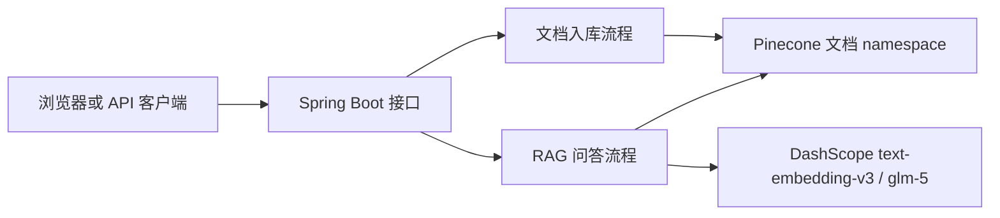

# AI README - 项目规则入口

## 项目总览
TeamRagKnowledgeBase 是一个面向 baituan 社团资料管理与问答的 Spring Boot RAG 知识库，核心能力是社团资料入库、语义分块、DashScope embedding、Pinecone hybrid 检索和 glm-5 流式问答。



## 生成信息
- 生成时间：2026-06-04 20:09
- 当前维护分支：main
- 运行链路与权限说明已按2026-11-08代码更新，最新总览见根目录README。

## 快速导航
### AI 生成文档（generated/）
- [x] [项目结构](./generated/项目结构.md) - 目录树、模块划分；了解代码组织时使用 (2026-06-04 20:09)
- [x] [技术架构](./generated/技术架构.md) - 分层架构、技术栈；了解技术选型时使用 (2026-06-04 20:09)
- [x] [开发指南](./generated/开发指南.md) - 环境搭建、构建/启动命令；上手时使用 (2026-06-04 20:09)
- [x] [核心流程](./generated/核心流程.md) - 主要业务调用链；理解系统时使用 (2026-06-04 20:09)

### 人工维护文档（manual/）
- [ ] [业务知识](./manual/业务知识.md) - 项目背景、领域术语、业务规则
- [ ] [历史经验](./manual/历史经验.md) - 踩坑记录；写代码前必读

## 使用方式
AI Agent 进入项目时先读项目根目录 `AGENTS.md`，再按任务类型阅读本目录下的 generated 或 manual 文档。

```text
入口 AGENTS.md -> 本 README -> generated 技术事实 -> manual 团队补充
```

## 当前设计入口
- [根目录README](../../../README.md)：当前结构、功能、入库/问答链路和本机启动。
- [记忆及权限边界](../../../docs/MEMORY_AND_ACCESS_DESIGN.md)：用户画像、租户绑定、角色权限、迁移与能力边界。
- [分类分块](../../../docs/CHUNKING_STRATEGY.md)：结构解析、FAQ/制度/表格、父子检索。

个人长期记忆不再与RAG证据混用。生产JDBC执行V1/V2/V3；认证模式固定部署租户，namespace按租户隔离，数据库拒绝其他租户混用。文档写入限ADMIN/EDITOR且新版本校验源/目标项目。
