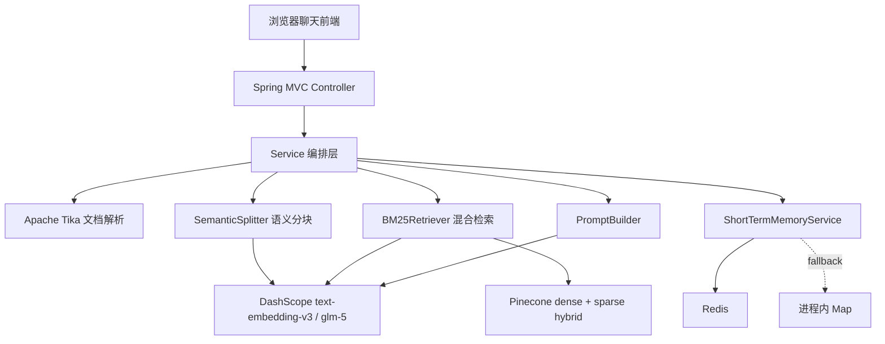

<!-- AI生成，可根据团队规范更新 -->
# 技术架构

## 架构总览

## 分层说明
| 分层 | 职责 | 主要类/文件 |
| --- | --- | --- |
| 表现层 | 静态聊天页面、文档上传表单、调用后端 API | `src/main/resources/static/index.html`, `app.js`, `styles.css` |
| API 层 | 暴露上传和问答接口，声明 Swagger 信息 | `DocumentController`, `RagQAController` |
| 业务编排层 | 串联文档入库、问答、记忆、召回、模型生成 | `DocumentService`, `RagQAService` |
| 模型和向量库适配层 | 统一封装 DashScope OpenAI 兼容接口与 Pinecone REST API | `DashScopeClient`, `PineconeClient` |
| 工具层 | 语义分块、BM25 sparse 编码、hybrid query、提示词构建 | `SemanticSplitter`, `BM25SparseEncoder`, `BM25Retriever`, `PromptBuilder` |
| 配置层 | 绑定 `.env` 和 `application.properties`，创建基础 Bean | `DotenvApplicationListener`, `RagProperties`, `RAGConfig` |
| 数据对象层 | API 入参、响应、文档片段、检索片段、稀疏向量 | `bean` 包 |

## 技术栈
| 类目 | 技术 | 版本 | 用途 |
| --- | --- | --- | --- |
| 语言/运行时 | Java | 17 | 后端运行和编译目标 |
| 主框架 | Spring Boot | 3.2.6 | Web API、配置、依赖注入 |
| HTTP 客户端 | Spring WebFlux WebClient / Reactor Netty | Spring Boot 管理 | 调用 DashScope 和 Pinecone |
| RAG 基线依赖 | LangChain4j | 1.0.0-beta3 | 保留 RAG 框架依赖，业务按其流程组织 |
| 文档解析 | Apache Tika | 2.9.2 | 解析 PDF、Word、TXT、Markdown、HTML 等文本 |
| API 文档 | springdoc-openapi | 2.5.0 | Swagger UI |
| 向量模型 | DashScope `text-embedding-v3` | 由配置决定 | 生成 1024 维 dense embedding |
| Chat 模型 | DashScope/OpenAI 兼容 `glm-5` | 由配置决定 | 查询重写、摘要、流式问答 |
| 向量数据库 | Pinecone | REST API | 文档与长期记忆 namespace 的 dense + sparse hybrid 检索 |
| 短期记忆 | Redis / 进程内 Map | Spring Data Redis | 会话窗口保存，Redis 不可用时本地兜底 |
| 构建工具 | Maven | Wrapper 未提供 | 编译、测试、启动 |
| 测试框架 | JUnit 5 / AssertJ | Spring Boot Test 管理 | `.env` 解析和 BM25 sparse 编码测试 |

## 配置入口
| 配置 | 来源 | 默认值或说明 |
| --- | --- | --- |
| `rag.dashscope.api-key` | `.env` / 环境变量 | 读取 `DASH_SCOPE_API_KEY`，并兼容 `REPOPILOT_GLM_API_KEY`、`GLM_API_KEY`、`DASHSCOPE_API_KEY` |
| `rag.dashscope.embedding-model` | `DASH_SCOPE_EMBEDDING_MODEL` | `text-embedding-v3` |
| `rag.dashscope.chat-model` | `DASH_SCOPE_CHAT_MODEL` | `glm-5` |
| `rag.pinecone.index` | `PINECONE_INDEX` | 必填 |
| `rag.pinecone.host` | `PINECONE_HOST` | 可选；不填时从 Pinecone 控制面查询 |
| `rag.pinecone.namespace` | `PINECONE_NAMESPACE` | `team-rag-documents` |
| `rag.pinecone.memory-namespace` | `PINECONE_MEMORY_NAMESPACE` | `team-rag-memory` |
| `rag.qa.general-fallback-enabled` | `RAG_QA_GENERAL_FALLBACK_ENABLED` | `true`，知识库无命中时转通用大模型兜底 |

## 关键设计
- `DashScopeClient` 直接调用 OpenAI 兼容路径 `/embeddings` 和 `/chat/completions`，embedding 与 chat 共用同一个配置对象。
- `PineconeClient` 负责 upsert 和 query，query 时按 `alpha` 缩放 dense/sparse 权重。
- `BM25Retriever` 把查询同时转换成 dense vector 和 sparse vector，再交给 Pinecone hybrid query。
- `ShortTermMemoryService` 优先写 Redis，失败时使用进程内 `ConcurrentHashMap` 兜底，便于本地没有 Redis 时继续调试。
- `DotenvApplicationListener` 在 Spring 配置绑定前加载项目根目录 `.env`，不要把真实密钥提交到仓库。
