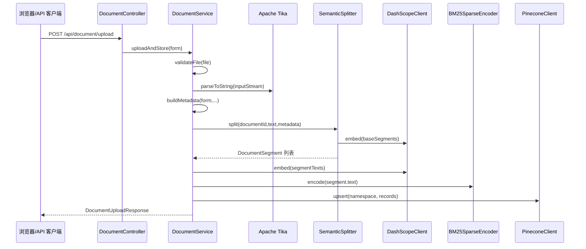
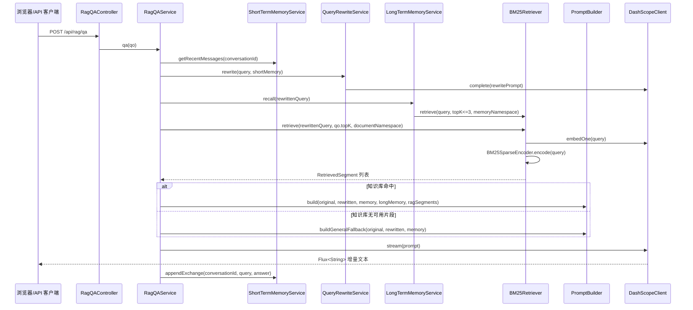
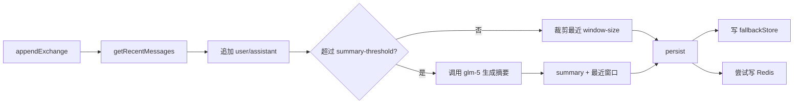

<!-- AI生成，可根据团队规范更新 -->
# 核心流程

> 提示：以下流程由 AI 从当前代码推断而来，请团队确认 P0/P1 是否就是业务上的核心优先级。

## 流程清单
| 优先级 | 流程名 | 入口 | 备注 |
| --- | --- | --- | --- |
| P0 | 文档上传入库 | `DocumentController.upload` | 解析资料、分块、embedding、BM25 sparse、写入 Pinecone |
| P0 | RAG 流式问答 | `RagQAController.qa` | 短期记忆、查询重写、长期记忆、hybrid 检索、glm-5 流式生成 |
| P0 | 通用大模型兜底 | `RagQAService.qa` | 知识库和长期记忆均无可用片段时，转通用模型回答并标注知识库未命中 |
| P1 | 短期记忆压缩 | `ShortTermMemoryService.appendExchange` | 会话过长时调用模型摘要早期消息 |
| P1 | 前端聊天交互 | `src/main/resources/static/app.js` | 浏览器上传文件并通过 SSE 接收问答流 |

## 流程 1：文档上传入库

### 调用链
1. `DocumentController.upload(@ModelAttribute DocumentForm form)`
2. `DocumentService.uploadAndStore(DocumentForm form)`
3. `DocumentService.validateFile(MultipartFile file)`
4. `Tika.parseToString(InputStream inputStream)`
5. `DocumentService.buildMetadata(...)`
6. `SemanticSplitter.split(String documentId, String text, Map<String,Object> baseMetadata)`
7. `DashScopeClient.embed(List<String> texts)`
8. `BM25SparseEncoder.encode(String text)`
9. `PineconeClient.upsert(String namespace, List<VectorRecord> records)`

### 关键分支
- `file` 为空或超过 `rag.document.max-upload-size-mb` 时直接抛出业务异常。
- Tika 没有解析出有效文本时抛出 `文档未解析出有效文本`。
- `docType` 空值回退为 `未分类`，`project` 空值回退为 `default`，`tags` 和 `description` 空值回退为空字符串。
- `SemanticSplitter` 先切基础片段，再用 embedding 余弦相似度合并相邻片段。
- Pinecone 写入的 metadata 中包含 `text`，后续检索片段从 metadata 取回原文。

## 流程 2：RAG 流式问答

### 调用链
1. `RagQAController.qa(@Valid @RequestBody RagQo qo)`
2. `RagQAService.qa(RagQo qo)`
3. `ShortTermMemoryService.getRecentMessages(String conversationId)`
4. `QueryRewriteService.rewrite(String query, List<ChatMessage> shortMemory)`
5. `LongTermMemoryService.recall(String rewrittenQuery)`
6. `BM25Retriever.retrieve(String query, Integer topK, String namespace)`
7. `DashScopeClient.embedOne(String text)`
8. `PineconeClient.query(String namespace, float[] denseVector, SparseVector sparseVector, int topK, double alpha, double minScore)`
9. `PromptBuilder.build(...)` 或 `PromptBuilder.buildGeneralFallback(...)`
10. `DashScopeClient.stream(String prompt)`
11. `ShortTermMemoryService.appendExchange(...)`

### 关键分支
- `query` 由 `RagQo` 的 `@NotBlank` 校验，不能为空。
- 会话 ID 优先使用 `conversationId`，其次兼容 `memoryId`，都为空时使用 `default`。
- 没有短期记忆时，查询重写直接返回原问题。
- 查询重写失败时吞掉异常并返回原问题，避免问答主流程中断。
- 长期记忆召回失败时返回空列表，继续执行普通文档 RAG。
- 长期记忆和文档检索都没有可用文本片段，且 `rag.qa.general-fallback-enabled=true` 时，转通用大模型兜底回答。
- 通用兜底答案会追加 `rag.qa.general-fallback-prefix` 前缀，明确提示该答案不是知识库事实。
- `topK` 为空或小于等于 0 时使用 `rag.hybrid.top-k` 默认值。
- `stream-enabled=false` 时，`DashScopeClient.stream` 会退化为一次性 `complete(prompt)`。
- 回答流完成后才追加短期记忆；如果流中断，当前轮对话可能不会写入短期记忆。

## 流程 3：短期记忆保存与压缩

### 调用链
1. `ShortTermMemoryService.appendExchange`
2. `ShortTermMemoryService.compactIfNeeded`
3. `DashScopeClient.complete`
4. `ShortTermMemoryService.persist`

### 关键分支
- Redis 读写失败时记录 debug 日志并使用内存 Map。
- 消息超过阈值时，早期消息会被模型压缩成一条 `summary` 角色消息。
- 摘要生成失败时使用固定兜底摘要。
