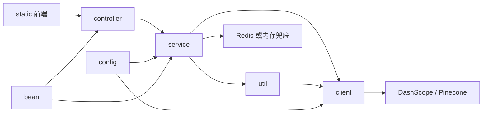

<!-- AI生成，可根据团队规范更新 -->
# 项目结构

## 目录树
```text
TeamRagKnowledgeBase/
|-- pom.xml
|-- README.md
|-- .env.example
|-- src/
|   |-- main/
|   |   |-- java/com/team/rag/
|   |   |   |-- TeamRagApplication.java
|   |   |   |-- bean/
|   |   |   |-- client/
|   |   |   |-- config/
|   |   |   |-- controller/
|   |   |   |-- service/
|   |   |   `-- util/
|   |   `-- resources/
|   |       |-- application.properties
|   |       `-- static/
|   |           |-- index.html
|   |           |-- styles.css
|   |           |-- app.js
|   |           `-- favicon.svg
|   `-- test/java/com/team/rag/
|       |-- config/
|       `-- util/
`-- .codex/rules/ai-readme/
    |-- README.md
    |-- generated/
    `-- manual/
```

## 模块职责
| 目录 | 职责 | 关键文件 |
| --- | --- | --- |
| `src/main/java/com/team/rag` | Spring Boot 应用入口和 RAG 后端主包 | `TeamRagApplication.java` |
| `bean` | 请求、响应和领域数据对象 | `DocumentForm.java`, `RagQo.java`, `DocumentSegment.java`, `RetrievedSegment.java` |
| `config` | .env 加载、配置绑定、WebClient/Tika/DashScope/Pinecone Bean | `DotenvApplicationListener.java`, `RagProperties.java`, `RAGConfig.java` |
| `controller` | HTTP API 入口和全局异常处理 | `DocumentController.java`, `RagQAController.java`, `GlobalExceptionHandler.java` |
| `service` | 文档入库、RAG 问答、短期记忆、查询重写、长期记忆召回 | `DocumentService.java`, `RagQAService.java`, `ShortTermMemoryService.java` |
| `client` | 外部模型和向量库 REST 适配器 | `DashScopeClient.java`, `PineconeClient.java` |
| `util` | 分块、BM25 sparse 编码、混合检索和提示词构建 | `SemanticSplitter.java`, `BM25SparseEncoder.java`, `BM25Retriever.java`, `PromptBuilder.java` |
| `src/main/resources/static` | 浏览器聊天前端和文档上传页面 | `index.html`, `app.js`, `styles.css` |
| `src/test/java/com/team/rag` | 单元测试 | `DotenvApplicationListenerTest.java`, `BM25SparseEncoderTest.java` |

## 模块依赖关系


## 结构约定
- Controller 只负责 HTTP 入参出参，不直接调用 DashScope 或 Pinecone。
- Service 编排业务流程，复杂算法或提示词拼装放到 `util`。
- 外部 HTTP 调用集中在 `client`，避免业务层散落第三方 API 细节。
- 模型、Pinecone、分块、检索和记忆参数集中从 `RagProperties` 读取。
