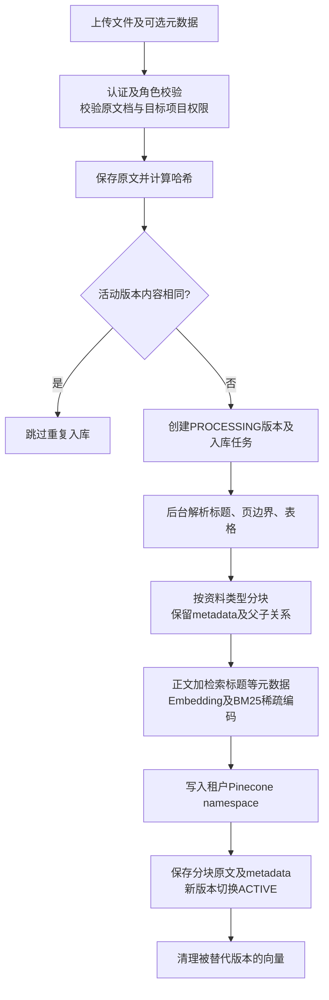
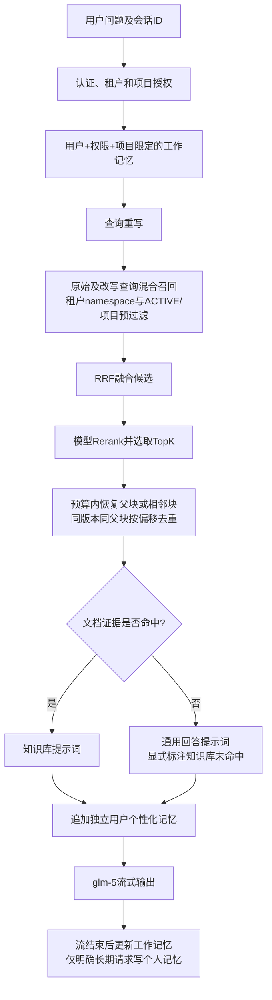

# TeamRagKnowledgeBase

baituan 社团资料 RAG 智能知识库，面向社团介绍、社团章程、招新材料、活动指引、预算报销、安全预案和活动复盘等资料的管理与问答场景。

项目采用 `config / service / util / bean / controller` 分层，包含短期记忆、查询重写、长期记忆召回和 Pinecone dense + sparse hybrid 检索流程。当前默认业务内容已切换为 baituan 社团资料知识库。

## 技术选型

- SpringBoot 3.2.6
- Java 17
- LangChain4j 1.0.0-beta3
- Apache Tika 文档解析
- 阿里百炼 `text-embedding-v3` 向量模型，1024 维
- 阿里百炼 `glm-5` 大模型
- Pinecone 向量数据库
- BM25 sparse vector + dense vector 混合检索
- Redis 短期记忆，未启动 Redis 时自动回退到进程内记忆
- WebFlux `Flux` 流式输出
- Spring Security 可选登录认证、角色权限和项目级数据隔离
- JDBC 文档生命周期仓储，可用于 MySQL 生产持久化
- 本地文件 / S3 兼容对象存储，用于保存原始上传文档

> 说明：LangChain4j 作为 RAG 工程基线依赖保留。考虑到 `1.0.0-beta3` 的 DashScope / Pinecone 集成 API 在不同版本里变化较大，项目把模型调用和 Pinecone 调用封装成 Adapter，保证本项目更容易直接运行。

## 项目结构

```text
TeamRagKnowledgeBase/
├── pom.xml                         # Java 17 / Maven 依赖与测试配置
├── .env.example                    # 可提交的配置模板；真实配置在被忽略的 .env
├── AGENTS.md                       # 项目开发边界和专项规则
├── docs/                           # 分块、记忆权限设计与评测说明
├── knowledge-base/baituan-club-materials/ # 20份资料模板和 manifest.csv
├── scripts/                        # 批量导入、评测和本地启动脚本
├── src/main/java/com/team/rag/
│   ├── TeamRagApplication.java      # 加载 .env 并启动
│   ├── controller/                 # 认证、文档、流式问答、个人记忆治理 API
│   ├── service/                    # 入库任务、原文存储、问答与记忆编排
│   │   ├── DocumentService.java
│   │   ├── DocumentIngestionWorker.java
│   │   ├── DocumentIngestionService.java
│   │   ├── RagQAService.java
│   │   ├── QueryRewriteService.java
│   │   ├── QueryFusionService.java
│   │   ├── RerankService.java
│   │   ├── ChunkContextExpander.java
│   │   ├── ShortTermMemoryService.java
│   │   └── UserLongTermMemoryService.java
│   ├── util/                       # 结构解析、分类分块、稀疏编码及提示词
│   │   ├── StructuredDocumentParser.java
│   │   ├── AdaptiveChunker.java
│   │   ├── SemanticSplitter.java
│   │   ├── BM25Retriever.java
│   │   └── PromptBuilder.java
│   ├── client/                     # DashScope、Pinecone 外部调用适配
│   ├── repository/                 # 内存/JDBC 生命周期仓储
│   ├── security/                   # Token、账号、角色和项目授权
│   ├── config/                     # 模型、JDBC、租户数据库绑定等配置
│   └── bean/                       # 文档、分块、任务与接口对象
├── src/main/resources/
│   ├── application.properties
│   ├── static/                     # 原生 HTML/CSS/JS 上传与聊天界面
│   └── db/mysql/                   # V1生命周期、V2旧记忆、V3画像与租户绑定
├── src/test/java/                  # 单元测试及可选浏览器集成测试
└── data/                           # 本地原文、数据库及升级备份；不提交
```

## 已实现功能

| 能力 | 当前实现 |
|---|---|
| 资料管理 | 文件上传、可选元数据、内容哈希去重、版本、异步任务、状态查询、失败恢复 |
| 原文存储 | 本地文件或 S3 兼容存储；生命周期支持内存/JDBC |
| 结构与分类分块 | 保留标题路径、可解析页码、时间、项目权限；FAQ按问题细分、制度按章节段落、表格独立；超长块按token预算兜底 |
| 检索 | dense+sparse混合检索；不支持稀疏查询时客户端混排；原始/改写查询的RRF融合、模型精排及条件父子块扩展 |
| 问答 | 查询重写、受预算约束的证据组装、glm-5流式回答、知识未命中显式提示 |
| 工作记忆 | Redis滑动窗口及摘要；Redis不可用时进程内降级，7天过期 |
| 用户长期记忆 | 认证用户跨会话画像；显式写入、结构化键覆盖、有限版本、TTL、查看/修改/删除/导出/暂停API；JDBC持久化 |
| 认证与隔离 | 服务端固定租户、租户Token与namespace、数据库绑定、角色写权限、项目预过滤、用户/项目/权限限定会话 |
| 前端 | 上传、新版本、类型选择说明、任务状态、登录和流式聊天；个人记忆治理暂通过API |

范围说明：当前为单JVM、每部署一个租户。不是同一进程多租户路由；未实现段落级ACL、字段DLP、合规不可篡改审计及多Agent共享记忆。扫描件或缺失结构的PDF受解析器能力限制，页码不虚构。详见 [记忆与权限设计](docs/MEMORY_AND_ACCESS_DESIGN.md) 和 [分块策略](docs/CHUNKING_STRATEGY.md)。

## 文档入库链路



`DocumentController → DocumentService → DocumentIngestionWorker → DocumentIngestionService` 为主调用链。模型和向量库调用集中于 `DashScopeClient`、`PineconeClient`。失败任务记录错误并由恢复机制重试；MySQL和Pinecone之间没有跨系统分布式事务，不应宣称全链路原子提交。

结构解析之后，短章节完整保留，普通长章节寻找语义边界；FAQ采用更小预算，制度优先段落边界，表格不混入普通正文。超长内容标记 `HARD_LIMIT`，保存版本绑定的 `parentId`、顺序及标准化UTF-16偏移。默认500代理tokens、FAQ最多200、兜底overlap50；计数器不是GLM原生tokenizer。

## 用户问答链路



`RagQAController → RagQAService` 负责问答编排，`QueryRewriteService / QueryFusionService / BM25Retriever / RerankService / ChunkContextExpander / PromptBuilder` 分别负责各阶段。个人记忆不能充当制度证据、覆盖权限或把“无文档命中”变成“知识库命中”。认证模式不读取旧的来源不明公共memory namespace。默认文档证据预算3000代理tokens，不包含完整提示词、工作记忆和输出预算。

## 社团资料种子库

项目内置了一批可直接入库的 baituan 社团资料，位置：

```text
knowledge-base/baituan-club-materials/
```

资料覆盖：

- 社团介绍、社团基础信息模板、社团章程模板。
- 入驻认证、招新、活动立项、场地物资、预算报销流程。
- 活动安全预案、工作人员分工、宣传发布、会员管理、换届流程。
- 活动签到数据统计、星级评定、FAQ、活动方案、复盘模板、权限规范。

启动项目后可以批量上传种子资料：

```powershell
powershell -ExecutionPolicy Bypass -File scripts/import-baituan-club-knowledge.ps1 `
  -BaseUrl "http://localhost:8080"
```

如果开启了登录认证，可附带 Token：

```powershell
powershell -ExecutionPolicy Bypass -File scripts/import-baituan-club-knowledge.ps1 `
  -BaseUrl "http://localhost:8080" `
  -Token "your-jwt-token"
```

## 配置

项目会在启动时读取根目录 `.env`。当前已经按要求复用原 RepoPilot 项目的 `.env`；真实密钥不要提交到 Git。

DashScope 支持这些变量，按顺序兜底：

```properties
DASH_SCOPE_API_KEY=
REPOPILOT_GLM_API_KEY=
GLM_API_KEY=
DASHSCOPE_API_KEY=
```

Pinecone 至少需要：

```properties
PINECONE_API_KEY=
PINECONE_INDEX=
PINECONE_REGION=us-east-1
```

`PINECONE_HOST` 可选；不填时服务会通过 Pinecone 控制面 API 自动查询 index host。

### 生产部署配置

生产建议至少开启 JDBC 生命周期仓储、对象存储和登录认证。

MySQL表结构位于 `src/main/resources/db/mysql/`。当前没有Flyway自动迁移，新部署按顺序执行V1、V2、V3；已有V1/V2的部署只执行缺失的V3，勿重复执行CREATE TABLE。

```properties
# 文档生命周期持久化
RAG_LIFECYCLE_REPOSITORY=jdbc
RAG_DB_URL=jdbc:mysql://127.0.0.1:3306/team_rag?useUnicode=true&characterEncoding=utf8&serverTimezone=Asia/Shanghai
RAG_DB_USERNAME=team_rag
RAG_DB_PASSWORD=change-me
RAG_DB_DRIVER_CLASS_NAME=com.mysql.cj.jdbc.Driver

# 原始文档对象存储，兼容 MinIO / S3
RAG_DOCUMENT_STORAGE_TYPE=s3
RAG_S3_ENDPOINT=http://127.0.0.1:9000
RAG_S3_REGION=us-east-1
RAG_S3_BUCKET=team-rag
RAG_S3_ACCESS_KEY=change-me
RAG_S3_SECRET_KEY=change-me
RAG_S3_PATH_STYLE_ACCESS=true
RAG_S3_PREFIX=rag-documents

# 入库 Worker 恢复扫描
RAG_INGESTION_RECOVERY_ENABLED=true
RAG_INGESTION_RECOVERY_FIXED_DELAY_MS=30000
RAG_INGESTION_RECOVERY_INITIAL_DELAY_MS=5000
RAG_INGESTION_RECOVERY_BATCH_SIZE=20

# 登录认证和项目权限
RAG_SECURITY_ENABLED=true
RAG_SECURITY_TOKEN_SECRET=replace-with-at-least-32-random-characters
RAG_SECURITY_TOKEN_TTL_MINUTES=720
RAG_SECURITY_USERS=admin:{bcrypt}xxxx:ADMIN:*;alice:{bcrypt}yyyy:USER:baituan|skating-club
```

`RAG_SECURITY_USERS` 的格式是：

```text
username:password:role:projectA|projectB;username2:password2:role:*
```

密码可以是明文，也可以使用 Spring Security 的 `{bcrypt}` 格式。生产环境建议只使用 `{bcrypt}`，并把该变量放在服务器密钥管理或 CI/CD Secret 中。

## 运行

```powershell
cd D:\JavaPrograms\TeamRagKnowledgeBase
mvn spring-boot:run
```

接口文档：

```text
http://localhost:8080/swagger-ui/index.html
```

网页端：

```text
http://localhost:8080/
```

如果 `RAG_SECURITY_ENABLED=true`，网页会先显示登录面板；如果未开启安全，网页会直接进入本地演示模式。

## 测试接口

上传文档：

```powershell
curl -X POST "http://localhost:8080/api/document/upload" `
  -F "file=@D:\docs\轮滑社社团章程.md" `
  -F "docType=社团章程" `
  -F "project=baituan" `
  -F "tags=社团,章程,组织架构"
```

RAG 问答：

```powershell
curl -N -X POST "http://localhost:8080/api/rag/qa" `
  -H "Content-Type: application/json" `
  -d "{\"query\":\"社团招新活动需要提前准备哪些材料？\",\"conversationId\":\"demo\",\"project\":\"baituan\"}"
```

## CI/CD

项目已增加 Gitee Go 流水线配置：`.workflow/team-rag-ci-cd.yml`。

触发条件：

- push 到 `main` 分支。
- 向 `main` 发起 Pull Request。

流水线执行内容：

1. `mvn -B -U clean test jacoco:report jacoco:check`
2. `mvn -B verify -Pintegration-tests`
3. 上传构建产物到 Gitee 默认制品库。
4. 发布 release 制品，制品名为 `team-rag-knowledge-base`。

覆盖率阈值在 `pom.xml` 中统一配置：

```properties
coverage.line.minimum=0.80
coverage.branch.minimum=0.75
coverage.method.minimum=1.00
```

流水线产物包括：

- `target/team-rag-knowledge-base-1.0.0.jar`
- `target/site/jacoco`
- `CODE_REVIEW_REPORT.md`
- `TEST_ACC_REPORT.md`

### Docker 部署

构建镜像：

```powershell
docker build -t team-rag-knowledge-base:latest .
```

使用 Compose 启动：

```powershell
docker compose -f deploy/docker-compose.prod.yml up -d --build
```

Compose 会读取项目根目录 `.env`。生产环境不要把真实 `.env` 提交到 Git，建议放在服务器目录或 Gitee Secret 中。

### systemd 主机部署

Linux 服务器可使用：

```bash
mvn -B -DskipTests package
scripts/deploy.sh
```

默认部署目录：

```text
/opt/team-rag-knowledge-base
```

默认 systemd 服务：

```text
team-rag.service
```

生产服务器需要提前准备：

- JDK 17
- MySQL
- Redis
- MinIO / S3
- 可访问的 Pinecone
- DashScope / GLM 相关 API Key
- `/opt/team-rag-knowledge-base/.env`

如果要做到真正自动部署到服务器，需要在 Gitee Go 中继续配置主机组或部署凭证，然后让部署步骤调用 `scripts/deploy.sh`。

## 生产优化

分块基准选型、实验指标与重排配置见 [分块评测集与召回后重排](docs/chunking-benchmarks-and-reranking.md)。文档召回默认使用 `gte-rerank-v2`：先召回 12 个候选，再取最终 topK（默认 6）；重排失败自动回退混合召回顺序。

- 中文分词可替换为 IK / jieba，提高 BM25 sparse token 质量。
- 对文档列表和入库任务增加分页、批量删除、重建索引、审计日志。
- Redis 短期记忆可扩展为滑动窗口 + 摘要 + 用户画像。
- 个人记忆已有独立治理API与JDBC持久化；后续可增加前端治理面板与经过评测的经历语义召回。
- 增加接口限流、熔断、ELK 日志和 Prometheus 指标。


### 用户记忆与租户部署边界

用户个人记忆与文档证据分离，支持认证用户查看、覆盖、删除、导出与暂停。文档写入需要 ADMIN/EDITOR；USER 仅按项目授权读取。启用认证后 Token、工作记忆和 Pinecone namespace 均绑定部署租户，升级需重新登录及重新入库。

生产 JDBC 部署须执行 `src/main/resources/db/mysql/V3__memory_profiles.sql`（在 V1/V2 之后），配置 `RAG_TENANT_ID`，为各租户分配独立数据库和原文存储目录/桶前缀。当前为单 JVM、单租户部署模式；个人记忆在无 JDBC 时只保存在进程内。完整对照、接口和未实现的企业能力见 [记忆与权限设计](docs/MEMORY_AND_ACCESS_DESIGN.md)。


## 本机升级后的启动方式

2026-11-08本机已建立项目独立MySQL实例（`127.0.0.1:3307`），数据库 `team_rag_baituan`，执行V1–V3，应用启用认证并切换JDBC，租户为 `baituan`。此段是本机运行记录，不是其他部署的默认参数。

```powershell
# 自动检查/启动已初始化的项目数据库，然后启动应用
powershell -ExecutionPolicy Bypass -File scripts/start-local.ps1
```

应用地址为 `http://localhost:8080`。管理员用户名为 `admin`；生成的随机登录密码保存在本地 `.env` 的 `RAG_SECURITY_USERS`（格式为用户名:密码:角色:项目），不在文档中公开。应用只用专属DML账号，不使用MySQL root。数据库管理员恢复信息仅在被忽略的 `data/mysql-local-admin.env`。此独立数据库由脚本启动，不是Windows自动启动服务；不要删除 `data/mysql-local`。

凭据、原文和数据库不会随Git发布。新电脑需自行准备MySQL并按 `.env.example` 配置。旧进程内任务未迁移为数据库文档；旧记忆无法可靠归属用户，未自动迁移。知识向量仍需重新入库，先前百炼账户欠费问题属于外部依赖，不由数据库升级解决。
